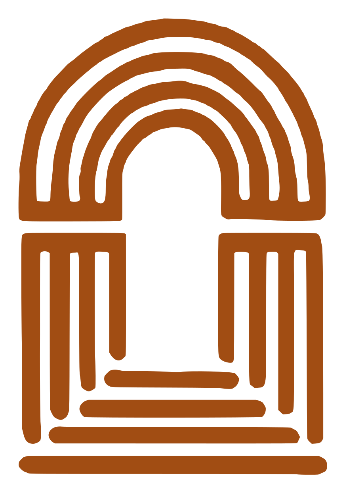

# Kirche Lebensfundament Website

A modern, responsive website for Kirche Lebensfundament in Bruchmühlbach-Miesau, built with React.



## 🎨 Features

- ✅ **Warm terracotta design** – colors taken from the church logo
- ✅ **Fully responsive** – tested on phones (360–430 px), tablets and desktop
- ✅ **Video hero** – calm looping video of an open Bible, with a poster frame while it loads
- ✅ **Events** – regular services and upcoming events in two tabs
- ✅ **Directions** – Google Maps for the church, parking and the train station, with a public transport route
- ✅ **Contact form** – sent by email via FormSubmit, with German validation messages
- ✅ **Legal pages** – Impressum and Datenschutzerklärung (templates with placeholders)

## 🚀 Technologies

- React 18 with [Vite](https://vite.dev) (requires Node.js 20.19+ or 22.12+)
- Plain CSS with design tokens (CSS custom properties)
- [AOS](https://michalsnik.github.io/aos/) for scroll animations
- Fonts: EB Garamond (headings) and Inter (body text), self-hosted via [Fontsource](https://fontsource.org) – no requests to Google
- Icons: inline SVGs from [Feather](https://feathericons.com) and [Phosphor](https://phosphoricons.com) (Bold)

## 📦 Installation

```bash
# Clone repository
git clone https://github.com/MarceloEito/lebensfundament-website.git
cd lebensfundament-website

# Install dependencies
npm ci

# Start development server
npm start
```

The website opens automatically at [http://localhost:3000](http://localhost:3000) and reloads on every change.

## 🏗️ Build for Production

```bash
npm run build
```

Creates an optimized production build in the `build` folder. `npm run preview` serves that build locally for a final check.

The Content-Security-Policy is defined in `vite.config.js` and only added to the production build.

## 📂 Project Structure

```
lebensfundament-website/
├── public/
│   ├── impressum/index.html    # Impressum (static page)
│   ├── datenschutz/index.html  # Datenschutzerklärung (static page)
│   ├── legal.css               # Shared styles for the legal pages
│   ├── logo.svg                # Church logo (vector) + PNG icons
│   ├── og-image.jpg            # Link preview image (1200×630)
│   ├── admin/                  # Admin area for event flyers (Sveltia CMS)
│   ├── uploads/events/         # Uploaded event flyers
│   ├── videos/                 # Hero video + poster frame
│   └── *.jpg                   # Church photos and posters (not used yet)
├── src/
│   ├── components/
│   │   ├── Header.jsx          # Logo, navigation, mobile menu
│   │   ├── Hero.jsx            # Video hero with info bar
│   │   ├── WhatToExpect.jsx    # "Über uns" section
│   │   ├── Events.jsx          # Regular services + upcoming events
│   │   ├── MapSection.jsx      # "Besuche uns": address, parking, train station
│   │   ├── ContactForm.jsx     # Contact form (FormSubmit)
│   │   ├── Location.jsx        # Address banner
│   │   └── Footer.jsx          # Footer with legal links
│   ├── data/events.json        # Upcoming event flyers (edited via /admin)
│   ├── formSubmit.js           # FormSubmit recipient + request helper
│   ├── index.css               # Design tokens and shared styles
│   ├── App.jsx
│   └── index.jsx
├── index.html                  # HTML shell, fonts, share preview tags
├── vite.config.js              # Build config incl. Content-Security-Policy
└── package.json
```

## 🎨 Customization

### Colors and fonts
All colors, fonts, shadows and spacing are defined once as CSS variables at the top of `src/index.css`, e.g.:
- **Terracotta**: `--color-orange: #ab4d13`
- **Text**: `--color-text-primary: #1c1410`
- **Heading font**: `--font-heading` and `--font-heading-weight`

### Content
- **Regular services and upcoming events**: `src/components/Events.jsx` (upcoming events are placeholders for now)
- **Service times in the footer**: `src/components/Footer.jsx`
- **Address, parking and station maps**: `src/components/MapSection.jsx`
- **Contact form recipient**: `FORM_ENDPOINT` in `src/formSubmit.js`
- **Hero video**: replace `public/videos/background.mp4` (and `background-poster.jpg`)

### Event flyers (admin area)
Flyers for the "Kommende Events" tab are managed at **`/admin`** (e.g. `https://<site>.netlify.app/admin/`) with [Sveltia CMS](https://sveltiacms.app). Add an event with a flyer image, a short title and the date; saving commits to `main`, and Netlify publishes the change within 1–2 minutes. A flyer disappears automatically after its date, and the tab is hidden while there are no upcoming flyers. Uploaded images are scaled down and converted to WebP and stored in `public/uploads/events/`; the data lives in `src/data/events.json`. Settings: `public/admin/config.yml`.

Signing in requires write access to this GitHub repository:
- **Access token** (works right away): on GitHub create a *fine-grained personal access token* for this repository only with *Contents: Read and write*, then choose "Sign In Using Access Token".
- **Sign in with GitHub** (more convenient, one-time setup): create a GitHub OAuth App with callback URL `https://api.netlify.com/auth/done`, then add its client ID and secret in Netlify under *Site configuration → Access & security → OAuth → Install provider → GitHub*.

### Contact form
Messages from the contact form and the feedback button are forwarded by email by [FormSubmit](https://formsubmit.co) to the address in `src/formSubmit.js`. After the first submission FormSubmit sends an activation email to that address; messages only arrive once the "Activate Form" link has been confirmed. This may be needed again when the site moves to its real domain. Until then the forms show a "noch nicht freigeschaltet" notice.

### Feedback button (test phase)
On the Netlify test address (`*.netlify.app`) and in local development a "Feedback" button appears in the bottom right corner. Feedback is sent by email via FormSubmit, like the contact form (`src/formSubmit.js` holds the recipient for both). On the real domain the button is hidden automatically.

### Legal pages
`public/impressum/index.html` and `public/datenschutz/index.html` contain placeholders in `[square brackets]` that must be filled in before going live. They are templates, not legal advice.

## 🌐 Deployment

The site is a static build, so any static host works. Hosts that rebuild automatically on every push are recommended.

Set the environment variable **`SITE_URL`** to the public address (e.g. `https://www.example.de`) in the hosting settings. It is used for the link preview (`og:image`, `og:url`) shown when the site is shared on WhatsApp, Signal or Facebook. Locally it can go into a `.env` file (see `.env.example`).

- **Netlify** (recommended): connect the GitHub repo; build settings, Node version and security headers come from `netlify.toml`. Without a custom domain the site runs at `<name>.netlify.app` and is hidden from search engines (`noindex`) until a real domain is set.
- **Cloudflare Pages**: build command `npm run build`, output folder `build`
- **Vercel**: `npx vercel`

## 🔒 Branch Protection

`main` is protected by a repository ruleset ("Protect main"):
- ✅ Only the repository owner (admin) can push directly to `main`
- ✅ Everyone else works on a branch and opens a Pull Request
- ✅ Pull Requests need an approval from the code owner (`.github/CODEOWNERS`)
- ✅ New pushes after an approval require a fresh approval
- ❌ Force pushes and deleting `main` are blocked

### Workflow for Changes:

```bash
# Create new feature branch
git checkout -b feature/my-change

# Make changes and commit
git add .
git commit -m "Description of changes"

# Push branch
git push origin feature/my-change

# Create Pull Request on GitHub
```

## 📱 Contact

**Kirche Lebensfundament**
- 📍 Eichenhübel 12a, 66892 Bruchmühlbach-Miesau, Germany
- 🕐 Sunday Service: 11:00 AM
- 🙏 Prayer Meeting: Tuesday 6:30 PM
- 🎸 Youth: Friday 7:00 PM
- ⚡ Teens: Thursday 6:00 PM

## 📄 License

This project is private and created for Kirche Lebensfundament.

## 🙏 Credits

Developed with ❤️ for Kirche Lebensfundament

---

**"Jesus ist unser Lebensfundament" - "Jesus is our life foundation"**
